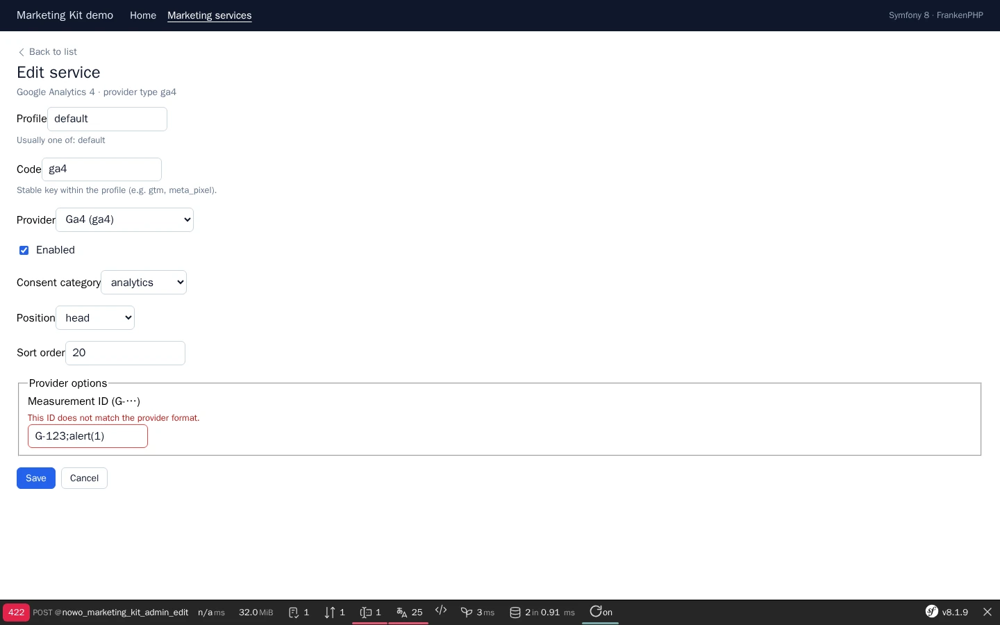

# Marketing Kit Bundle

[](https://github.com/nowo-tech/MarketingKitBundle/actions/workflows/ci.yml) [](https://packagist.org/packages/nowo-tech/marketing-kit-bundle) [](https://packagist.org/packages/nowo-tech/marketing-kit-bundle) [](LICENSE) [](https://php.net) [](https://symfony.com) [](https://github.com/nowo-tech/MarketingKitBundle) [](#tests-and-coverage)

> ⭐ **Found this useful?** Give it a star on GitHub! It helps us maintain and improve the project.

Symfony marketing kit: install and configure GTM, GA4, Meta Pixel, LinkedIn Insight, TikTok Pixel, Hotjar, Microsoft Clarity, and custom snippets via **YAML profiles** and/or **Doctrine**, with **CookieConsent-compatible** category gating.


This bundle is **FrankenPHP worker mode friendly**, including **kernel not reset** between requests (see [FrankenPHP worker audit](docs/FRANKENPHP-WORKER-AUDIT.md)).

<table>
  <tr>
    <td align="center" width="50%">
      
      <br /><sub>Admin list — providers with IDs, on/off state and row actions</sub>
    </td>
    <td align="center" width="50%">
      
      <br /><sub>Edit form — provider options with ID format validation</sub>
    </td>
  </tr>
</table>

## Features

- ✅ **Providers (v1)** — `gtm`, `ga4`, `meta_pixel`, `linkedin`, `tiktok`, `hotjar`, `clarity`, `custom`
- ✅ **YAML profiles** — `default_profile` + `profiles` (REQ-CFG-001)
- ✅ **Database override** — `use_database_config: true` replaces YAML tools when DB rows exist for the profile
- ✅ **Twig helpers** — `nowo_marketing_head()`, `nowo_marketing_body_start()`, `nowo_marketing_body_end()`
- ✅ **CookieConsent-compatible** — reads `Cookie_Category_{analytics|marketing}` (soft dependency)
- ✅ **Admin CRUD** — `/admin/marketing` (`web_ui.path_prefix`) to configure services (seed catalog, import YAML, toggle, typed option fields, confirm before delete)
- ✅ **Admin security** — `security.access_roles` (empty list denies) / custom `access_checker`, CSRF required, consent allowlist, optional CSP nonce; see [Security](docs/SECURITY.md) (demo-only `allow_unauthenticated`)
- ✅ **Embeddable admin UI** — UiKit page scaffolds (list + form): one host layout and theme (`nowo_ui_kit.layouts.admin`, `css_framework`, `theme`) for every Nowo bundle; see [Templates](docs/TEMPLATES.md)

**FrankenPHP:** Demos use a **single PHP service** (FrankenPHP, no nginx). Runtime mode is controlled by **`FRANKENPHP_MODE`** in `.env` (`worker` default, or `classic`). The entrypoint selects `Caddyfile` (workers) or `Caddyfile.dev` (no workers) accordingly; see [docs/DEMO-FRANKENPHP.md](docs/DEMO-FRANKENPHP.md). Demo URL: `http://localhost:8060` (see `demo/README.md` and `.env.example`).

## Installation

```bash
composer require nowo-tech/marketing-kit-bundle
```

```twig
{# templates/base.html.twig #}
<head>
    {{ nowo_marketing_head() }}
</head>
<body>
    {{ nowo_marketing_body_start() }}
    
    {{ nowo_marketing_body_end() }}
</body>
```

Optional GDPR gate (recommended):

```bash
composer require nowo-tech/cookie-consent-bundle
```

## Requirements

- PHP >= 8.2, < 8.6
- Symfony >= 7.4 || >= 8.0
- Doctrine ORM (for entities / optional DB config)
- [UiKitBundle](https://github.com/nowo-tech/UiKitBundle) ^2.15 (admin page scaffolds) and [FormKitBundle](https://github.com/nowo-tech/FormKitBundle) ^2.10

## Version information

| Version | PHP | Symfony | Status |
|---------|-----|---------|--------|
| 1.3.x | >= 8.2, < 8.6 | 7.4 – 8.x | Stable |
| 1.2.x | >= 8.2, < 8.6 | 7.4 – 8.x | Maintenance |
| 1.1.x | >= 8.2, < 8.6 | 7.4 – 8.x | Maintenance |
| 1.0.x | >= 8.2, < 8.6 | 7.4 – 8.x | Maintained |

## Quick configuration

```yaml
# config/packages/nowo_marketing_kit.yaml
nowo_marketing_kit:
    use_database_config: false
    respect_cookie_consent: true
    security:
        access_roles: ['ROLE_ADMIN']
        allow_unauthenticated: false
    web_ui:
        enabled: true
        path_prefix: /admin/marketing
        layout_template: null   # null = nowo_ui_kit.layouts.admin
    default_profile: default
    profiles:
        default:
            enabled: true
            tools:
                gtm:
                    type: gtm
                    enabled: true
                    category: analytics
                    position: head
                    options:
                        container_id: '%env(default::GTM_ID)%'
                gtm_noscript:
                    type: gtm
                    enabled: true
                    category: analytics
                    position: body_start
                    options:
                        container_id: '%env(default::GTM_ID)%'
                meta_pixel:
                    type: meta_pixel
                    enabled: false
                    category: marketing
                    position: head
                    options:
                        pixel_id: '%env(default::META_PIXEL_ID)%'
```

Import admin routes when using the database admin:

```yaml
# config/routes/nowo_marketing_kit.yaml
nowo_marketing_kit:
    resource: '@NowoMarketingKitBundle/Resources/config/routing.yaml'
```

## Demos

```bash
make -C demo up-symfony8
# Demo started at: http://localhost:8060
```

Playwright e2e and README screenshots (REQ-DEMO-013; both reset the demo database first):

```bash
make -C demo/symfony8 test-e2e           # happy path of the admin (seed, import, edit, toggle, delete)
make -C demo/symfony8 demo-screenshots   # refresh docs/images/demo/*.webp
```

## Documentation

- [Installation](docs/INSTALLATION.md)
- [Configuration](docs/CONFIGURATION.md)
- [Usage](docs/USAGE.md)
- [Contributing](docs/CONTRIBUTING.md)
- [Code of Conduct](CODE_OF_CONDUCT.md)
- [Changelog](docs/CHANGELOG.md)
- [Upgrading](docs/UPGRADING.md)
- [Release](docs/RELEASE.md)
- [Security](docs/SECURITY.md)
- [Engram](docs/ENGRAM.md)
- [Spec-driven development](docs/SPEC-DRIVEN-DEVELOPMENT.md)
- [GitHub Spec Kit](docs/SPEC-KIT.md)

### Additional documentation

- [Templates (UiKit page contract, REQ-UI-003)](docs/TEMPLATES.md)
- [PSR evaluation (REQ-CS-007)](docs/PSR.md)
- [GitHub Actions CI requirements](docs/GITHUB_CI.md)
- [Demo with FrankenPHP](docs/DEMO-FRANKENPHP.md) (includes worker mode)
- [FrankenPHP worker audit](docs/FRANKENPHP-WORKER-AUDIT.md) (kernel not reset / scenario B)
- [Server cookbook (Nginx, php-fpm, FrankenPHP)](docs/SERVERS.md)

## Tests and coverage

| Language | Lines (approx.) | Command |
| --- | --- | --- |
| PHP | 100% | `make test-coverage` |
| TypeScript | N/A | — |
| Python | N/A | — |

```bash
composer test
composer test-coverage
```

## License

The MIT License (MIT). Please see [LICENSE](LICENSE) for more information.
