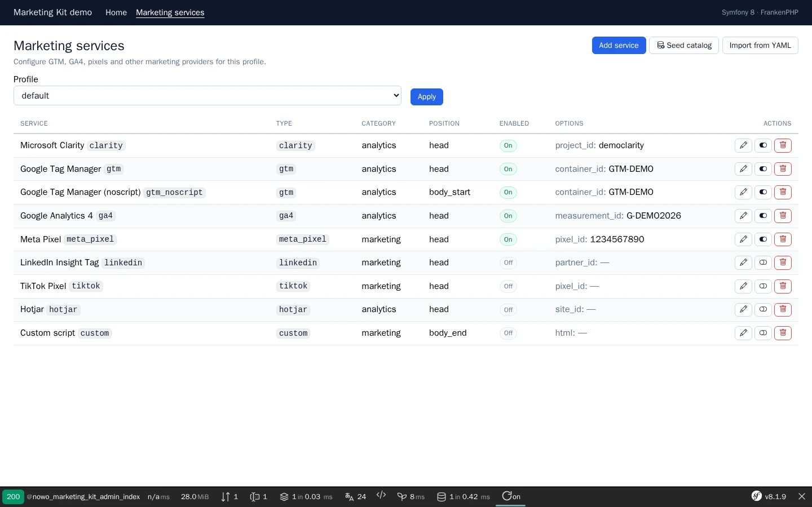

# Usage

## Table of contents

- [Layout helpers](#layout-helpers)
- [PHP API](#php-api)
- [GTM example](#gtm-example)
- [Database admin (CRUD)](#database-admin-crud)
- [Twig overrides](#twig-overrides)
  - [Upgrade-safe customisation first](#upgrade-safe-customisation-first)
  - [Overridable templates](#overridable-templates)
  - [Freeze vs upgrade](#freeze-vs-upgrade)
  - [Forms in the admin views (REQ-TWIG-005)](#forms-in-the-admin-views-req-twig-005)
- [Translation overrides](#translation-overrides)

## Layout helpers

```twig
<!DOCTYPE html>
<html>
<head>
    {{ nowo_marketing_head() }}
</head>
<body>
    {{ nowo_marketing_body_start() }}
    
    {{ nowo_marketing_body_end() }}
</body>
</html>
```

Optional profile argument: `{{ nowo_marketing_head('campaign') }}`.

CSP nonce (second argument, or `security.csp_nonce_attribute`): built-in `<script>` tags get `nonce="…"`; custom
HTML is emitted as configured.

```twig
{{ nowo_marketing_head(null, csp_nonce('script')) }}   {# NelmioSecurityBundle #}
```

Pages that render consent-gated tags get `Vary: Cookie` (do not cache them in a shared cache without it).

## PHP API

Inject `Nowo\MarketingKitBundle\Service\MarketingScriptRenderer`:

```php
$html = $renderer->renderHead();
$html = $renderer->renderBodyStart('default');
$html = $renderer->renderBodyEnd();
```

## GTM example

Enable both head + noscript tools sharing the same `container_id` (see recipe YAML).

## Database admin (CRUD)

With Doctrine schema created, open **`/admin/marketing`** (`web_ui.path_prefix`) to configure marketing services:

- List / filter by profile
- Create, edit, delete services
- Toggle enabled/disabled
- **Seed catalog** — creates GTM, GA4, Meta Pixel, LinkedIn, TikTok, Hotjar, Clarity, custom (disabled by default)
- **Import from YAML** — upsert tools from the YAML profile into the database

Set `use_database_config: true` so DB rows replace YAML tools at runtime when the profile has at least one row.

```bash
php bin/console doctrine:schema:update --force
# or a migration that creates marketing_tool
```

Secure `/admin/marketing*` with your firewall and `access_control` rules. The bundle denies access through `nowo_marketing_kit.security`, but host-level security is still required for the `/admin/marketing` path prefix.

The admin pages are UiKit page scaffolds (list + form; REQ-UI-003): they render inside `nowo_ui_kit.layouts.admin`
(your layout or a one-file bridge, set once for every Nowo bundle) and follow `nowo_ui_kit.css_framework`,
`icon_set`, `row_actions_display` and `theme`. Delete asks for confirmation in the UiKit `<dialog>`. See
[CONFIGURATION.md](CONFIGURATION.md#admin-web-ui-req-ui-001--req-ui-003) for Bootstrap / Tailwind / Foundation /
custom host setups and [TEMPLATES.md](TEMPLATES.md) for the page contract.

```yaml
nowo_ui_kit:
    css_framework: bootstrap5
    layouts:
        admin: 'layouts/admin.html.twig'
```

Keep `allow_unauthenticated: true` for demos only.



## Twig overrides

Namespace: `NowoMarketingKitBundle` (logical names `@NowoMarketingKitBundle/admin/index.html.twig`, …).

### Upgrade-safe customisation first

Prefer, in this order (none of them freezes a bundle file):

1. **UiKit theme** (`nowo_ui_kit.theme`: classes, attributes, partials, tokens; `theme.bundles.NowoMarketingKitBundle`
   for this bundle only) and the UiKit scaffold overrides under `templates/bundles/NowoUiKitBundle/page/` (one per
   view type, valid for every Nowo bundle).
2. **Layout**: `nowo_ui_kit.layouts.admin` (all bundles) or `nowo_marketing_kit.web_ui.layout_template` (this bundle).
3. **Per-page template** (`nowo_marketing_kit.web_ui.templates.<page>`): a host template that extends the bundle page
   and overrides one data block, e.g. an extra cell content:

   ```yaml
   nowo_marketing_kit:
       web_ui:
           templates:
               index: 'admin/marketing_index.html.twig'
   ```

   ```twig
   {# templates/admin/marketing_index.html.twig #}
   
   {{ parent() }}
   ```

4. **Translations** (`translations/NowoMarketingKitBundle.<locale>.yaml`) for any label.

### Overridable templates

Full-file override (REQ-TWIG-001): create `templates/bundles/NowoMarketingKitBundle/<subpath>` in the application;
it **always wins** over the bundle file (the bundle prepends that directory to its Twig namespace). Then
`bin/console cache:clear`.

| `<subpath>` | What it renders | Data blocks / variables |
|-------------|-----------------|-------------------------|
| `admin/index.html.twig` | Services list (UiKit list scaffold) | `nowo_ui_list_row`, `nowo_ui_content`; `page` (`ListPage`) + 1.x variables (see [TEMPLATES.md](TEMPLATES.md)) |
| `admin/form.html.twig` | Create / edit form (UiKit form scaffold) | `nowo_ui_form_body`, `nowo_ui_content`; `page` (`FormPage`), `form`, `tool`, `is_new` |
| `admin/_legacy_layout.html.twig` | Deprecated 1.x layout bridge (removed in 2.0) | `nowo_marketing_kit_layout` |

`admin/base.html.twig` and `admin/layout.html.twig` were removed in 1.9: an application copy of them is no longer
used (see [UPGRADING.md](UPGRADING.md)).

### Freeze vs upgrade

An application file at `templates/bundles/NowoMarketingKitBundle/<subpath>` **always wins and will not pick up
vendor changes for that path until you remove or merge it**: that file is frozen. Check
[UPGRADING.md](UPGRADING.md) ("Template contract") on every upgrade.

**Recovering upstream after a freeze:** delete (or rename aside) the application override, run
`bin/console cache:clear`, then re-apply only the customisation you still need through the upgrade-safe options above
(diff against `vendor/nowo-tech/marketing-kit-bundle/src/Resources/views/<subpath>` first).

### Forms in the admin views (REQ-TWIG-005)

Every control in the admin UI is a Symfony Form (types under `Nowo\MarketingKitBundle\Form`, FormKit options on the
editor): the service editor (`MarketingToolType`), the GET profile switcher (`ProfileFilterType`, query `?profile=`,
rendered in the list filters region) and the CSRF-only actions seed / import YAML / toggle / delete
(`CsrfActionType`, flat `_token` and hidden `profile`, same CSRF ids as before). The page view model carries them as
UiKit `Action`s (`Action::$form`), which the UiKit `action` partial renders with `form_start` / `form_end`; overrides
and demos must not reintroduce raw `<form>` / `<input>` / `<select>` markup. `MarketingToolAdminController::index()`
still passes `profile_form`, `seed_form`, `import_form`, `toggle_forms` and `delete_forms` (keyed by tool id) for 1.x
overrides; render each FormView only once per page.

## Translation overrides

Bundle UI strings use domain **`NowoMarketingKitBundle`** (locales: `en`, `es`, `it`, `fr`, `pt`, `de`, `nl`).

Override in the application:

```yaml
# translations/NowoMarketingKitBundle.es.yaml
admin.title: Mis herramientas de marketing
```

Application translations take precedence; missing keys fall back to the bundle (REQ-I18N-001).
